<!-- ===================== 헤더 ===================== -->

  

  

 

<!-- ===================== 웹 ===================== -->

  

<table>
  <tr>
    <td width="50%" align="center">
      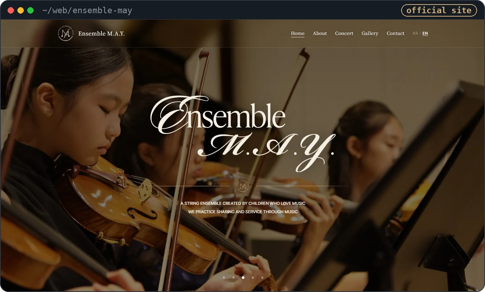
       <b>Ensemble M.A.Y.</b> &nbsp;·&nbsp; 음악을 사랑하는 아이들의 현악 앙상블 공식 홈페이지
    </td>
    <td width="50%" align="center">
      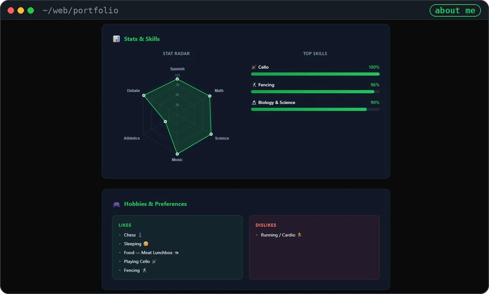
       <b>Portfolio</b> &nbsp;·&nbsp; 스탯 레이더로 보는 나
    </td>
  </tr>
</table>

<!-- ===================== 게임 ===================== -->

  

<table>
  <tr>
    <td width="50%" align="center">
      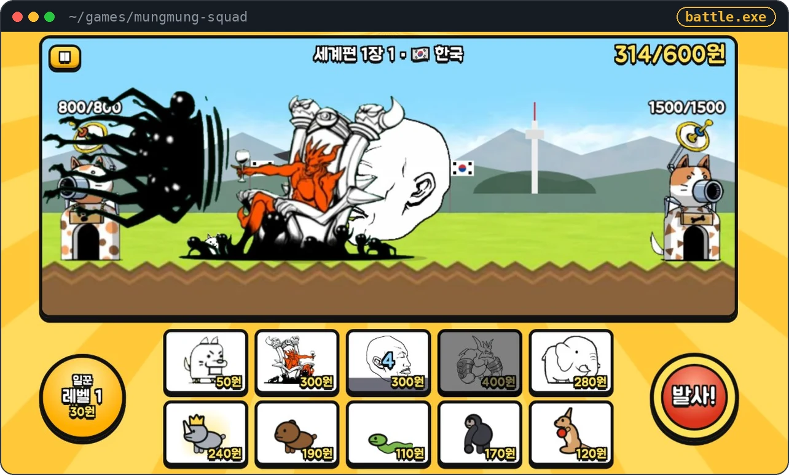
       <b>멍멍 특공대</b> &nbsp;·&nbsp; 냥코대전쟁 패러디 게임
    </td>
    <td width="50%" align="center">
      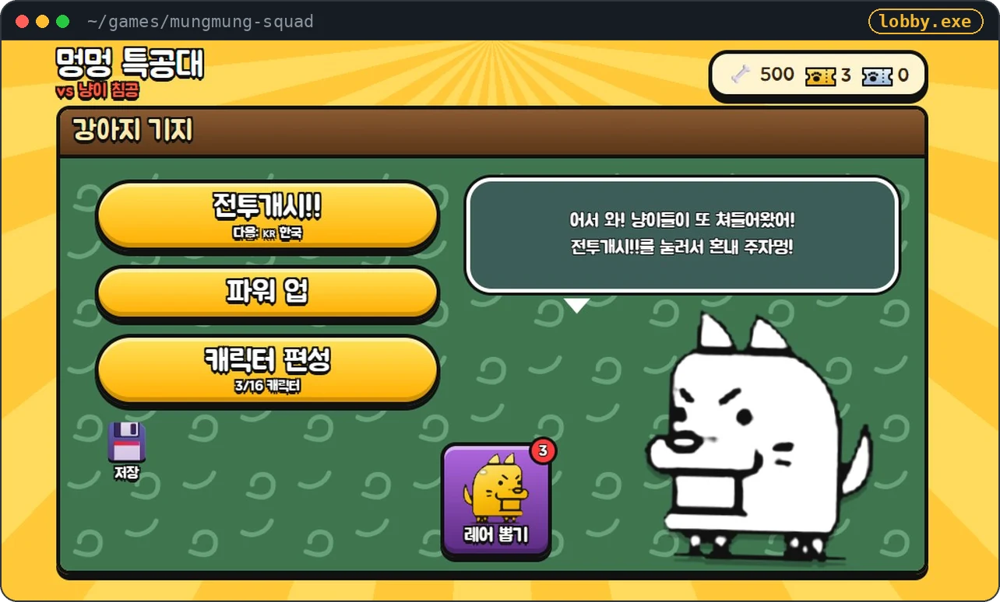
       파워 업, 캐릭터 편성, 레어 뽑기
    </td>
  </tr>
  <tr>
    <td width="50%" align="center">
      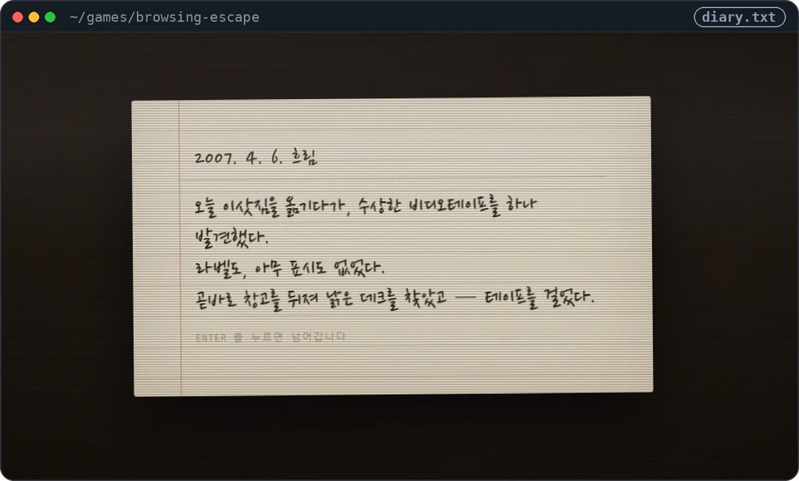
       <b>브라우징 탈출</b>비디오테이프
    </td>
    <td width="50%" align="center">
      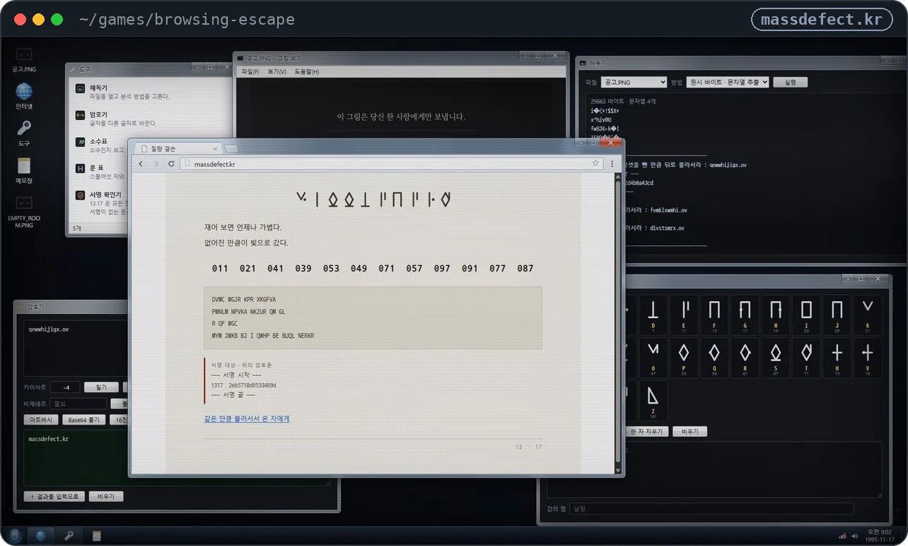
       <b>브라우징 탈출</b> &nbsp;·&nbsp; 암호와 단서로 문제풀기
    </td>
  </tr>
  <tr>
    <td width="50%" align="center">
      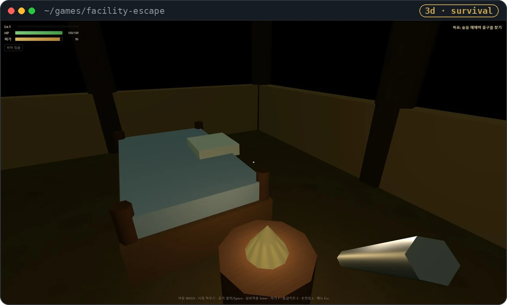
       <b>시설 탈출 게임</b> &nbsp;·&nbsp; 숲속
    </td>
    <td width="50%" align="center">
      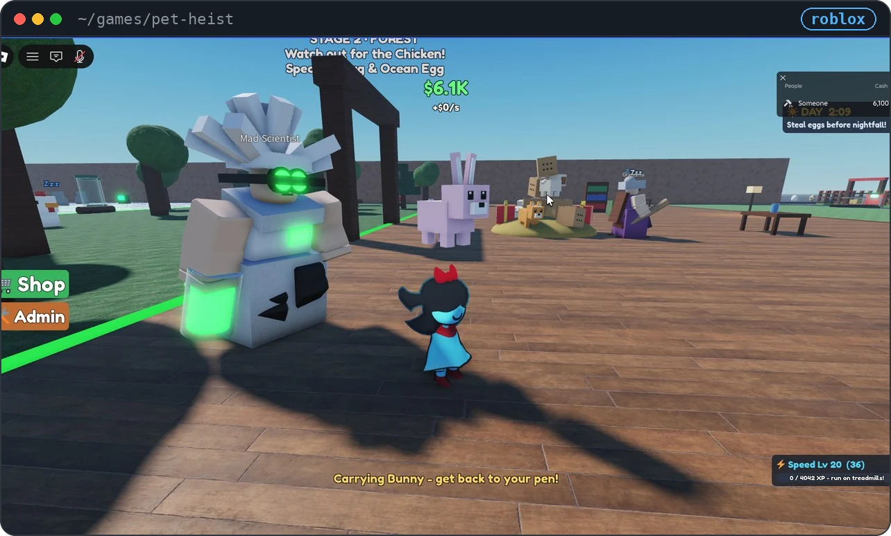
       <b>펫 가져오기</b> &nbsp;·&nbsp; 로블록스 스튜디오
    </td>
  </tr>
  <tr>
    <td width="50%" align="center">
      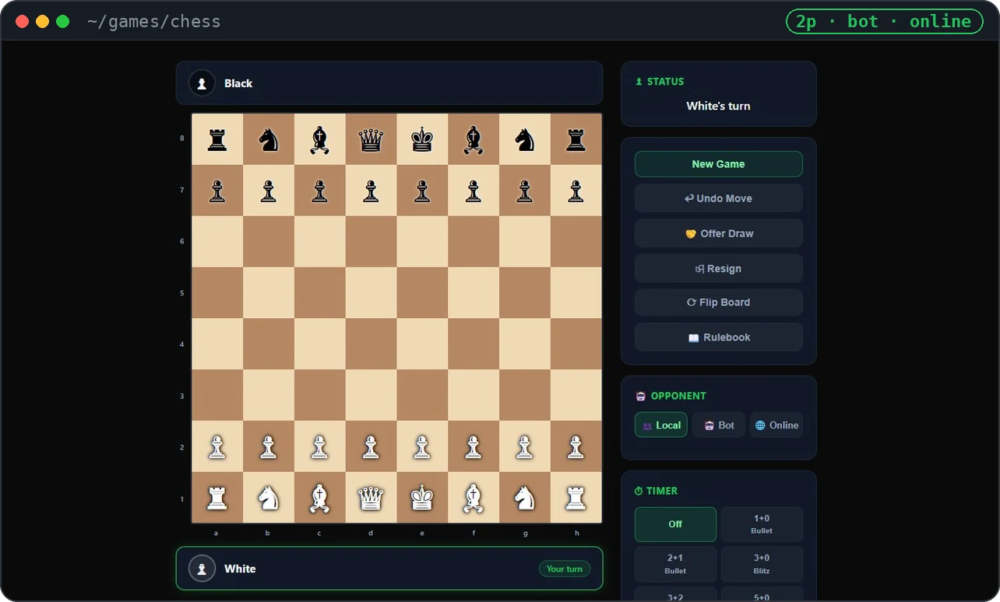
       <b>체스게임</b> &nbsp;·&nbsp; 봇과 플레이하는 체스
    </td>
    <td width="50%" align="center">
      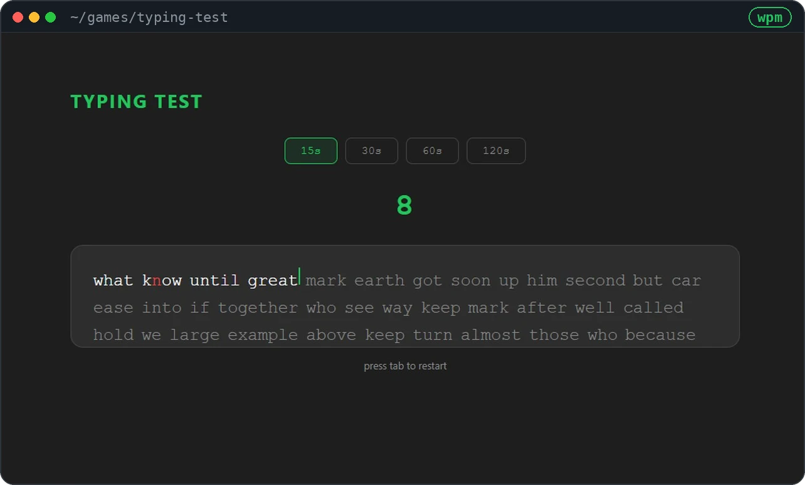
       <b>Typing Test</b> &nbsp;·&nbsp; 타자속도 측정 테스트
    </td>
  </tr>
  <tr>
    <td width="50%" align="center">
      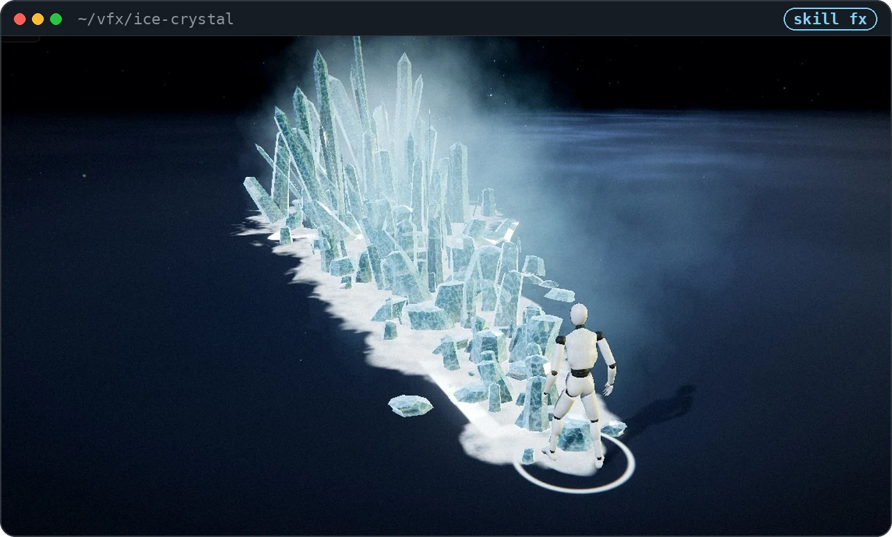
       <b>Ice Crystal</b> &nbsp;·&nbsp; 3D 에셋 활용
    </td>
    <td width="50%" align="center">
      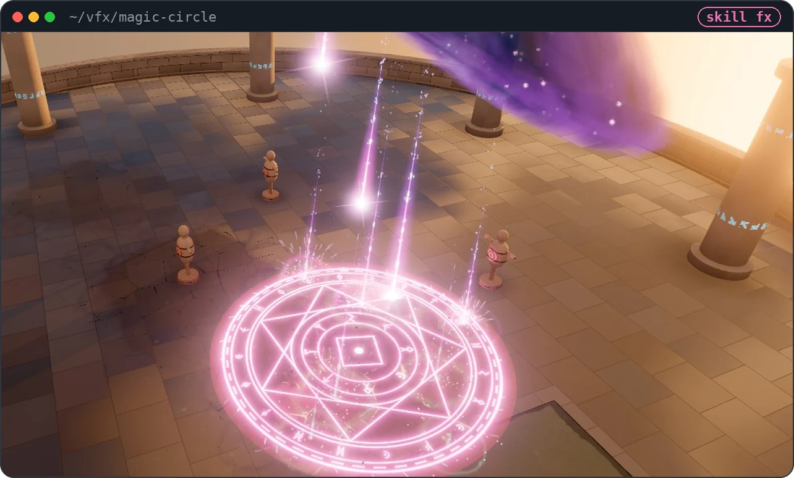
       <b>Magic Circle</b> &nbsp;·&nbsp; 3D 에셋 활용
    </td>
  </tr>
</table>

 

  <code>exit 0</code> &nbsp;·&nbsp; Made with 💜 by CIT-Code-Academy students · 지도 <a href="https://github.com/gyuribaik">백규리T</a>

