<!-- ===================== 헤더 ===================== -->

  

  

 

<!-- ===================== 게임 ===================== -->
## `~/games`

<table>
  <tr>
    <td colspan="2" align="center">
      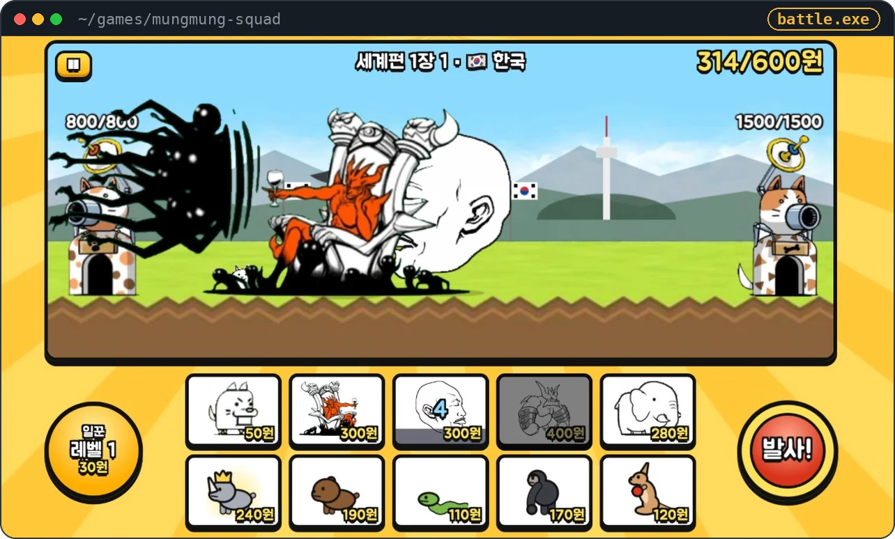
       <b>멍멍 특공대</b> &nbsp;·&nbsp; 냥이 침공에 맞서는 강아지 기지 디펜스
    </td>
  </tr>
  <tr>
    <td width="50%" align="center">
      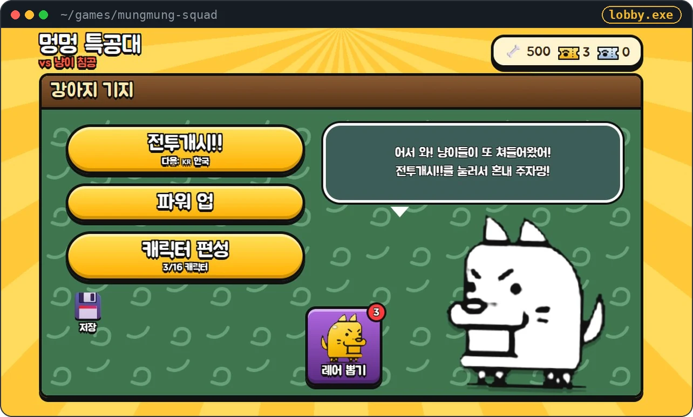
       파워 업 · 캐릭터 편성 · 레어 뽑기
    </td>
    <td width="50%" align="center">
      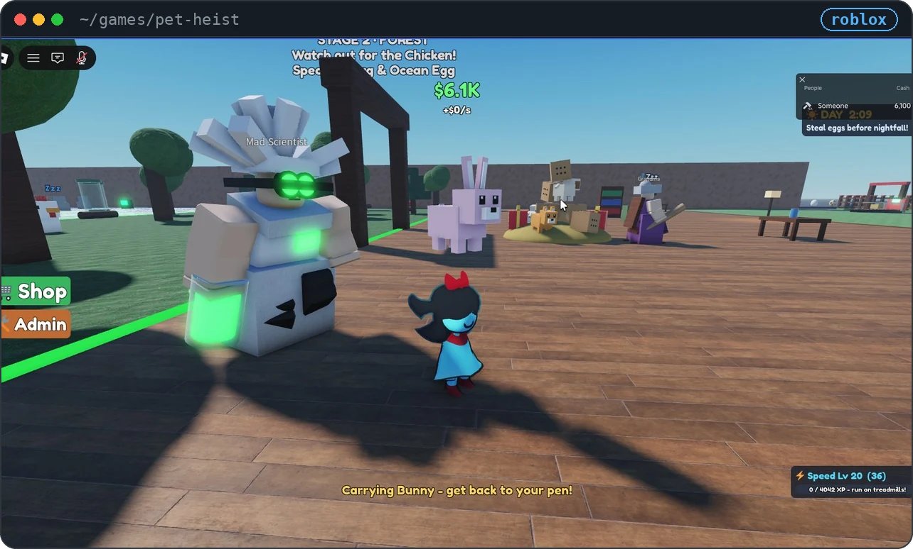
       <b>펫 가져오기</b> &nbsp;·&nbsp; 로블록스 · 밤이 오기 전에!
    </td>
  </tr>
  <tr>
    <td width="50%" align="center">
      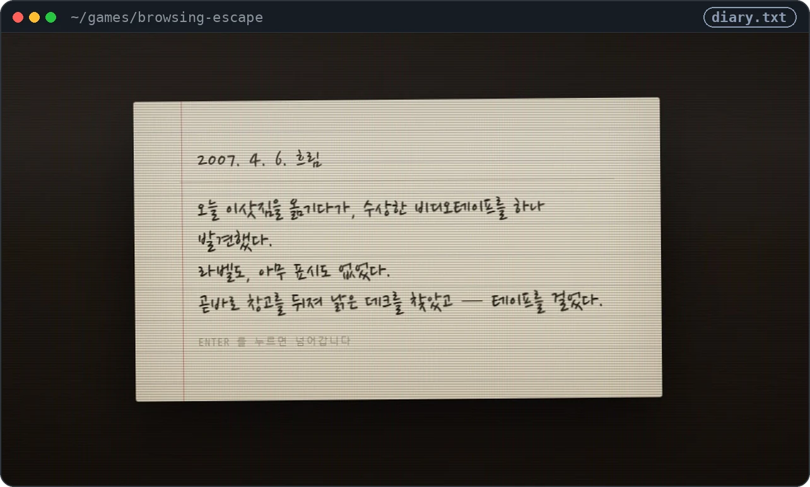
       2007. 4. 6. 흐림 — 라벨 없는 비디오테이프
    </td>
    <td width="50%" align="center">
      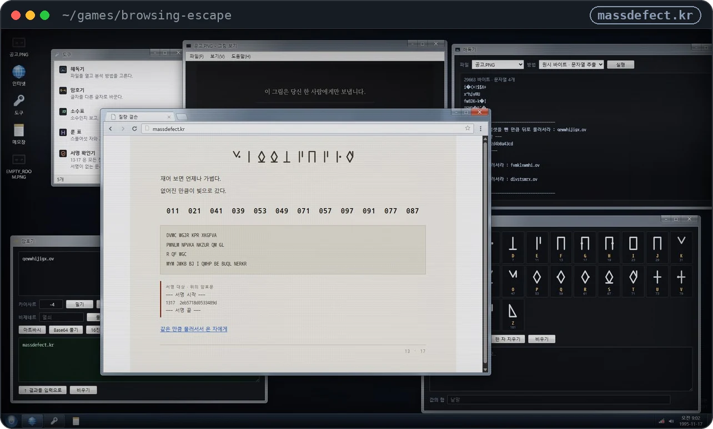
       <b>브라우징 탈출</b> &nbsp;·&nbsp; 암호와 단서로 빠져나가기
    </td>
  </tr>
  <tr>
    <td colspan="2" align="center">
      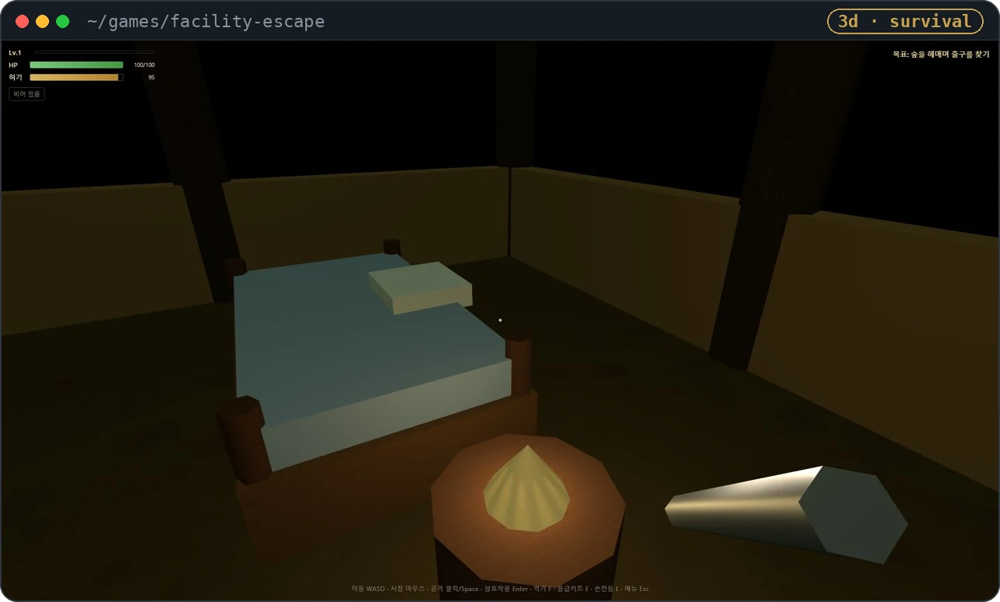
       <b>시설 탈출</b> &nbsp;·&nbsp; 숲을 헤매며 출구를 찾는 1인칭 생존
    </td>
  </tr>
  <tr>
    <td width="50%" align="center">
      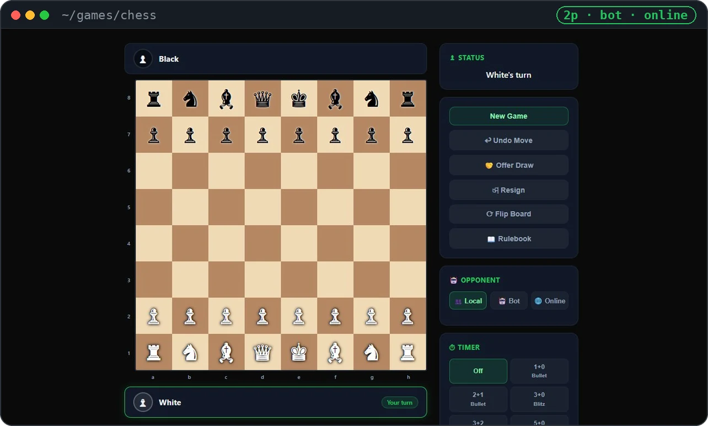
       <b>Chess</b> &nbsp;·&nbsp; 로컬 · 봇 · 온라인
    </td>
    <td width="50%" align="center">
      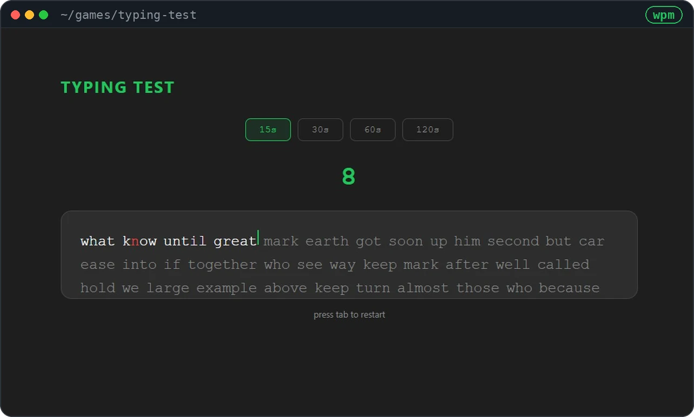
       <b>Typing Test</b> &nbsp;·&nbsp; 15초부터 120초까지
    </td>
  </tr>
</table>

<!-- ===================== 이펙트 ===================== -->
## `~/vfx`

<table>
  <tr>
    <td width="50%" align="center">
      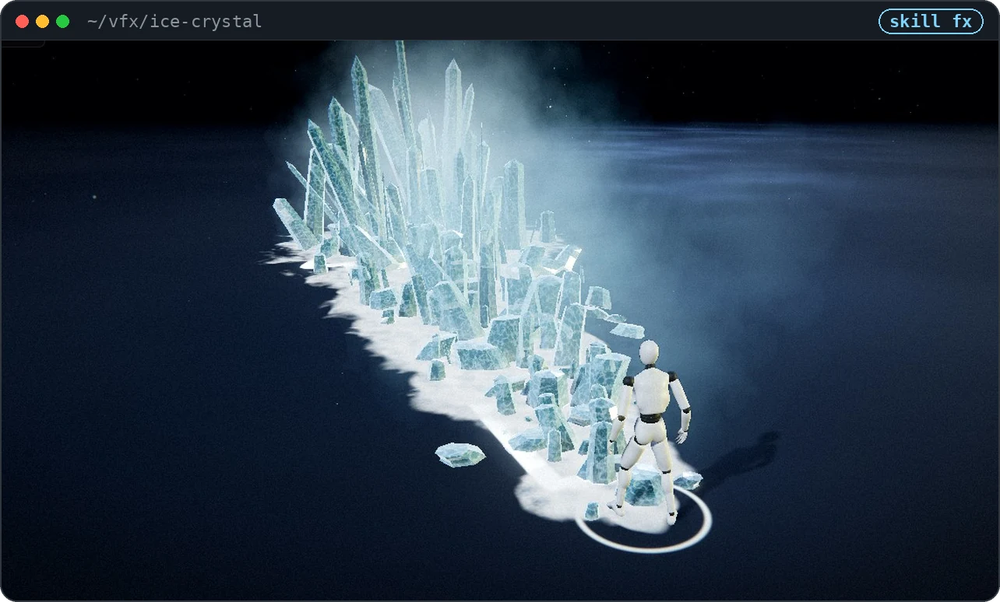
       <b>Ice Crystal</b>
    </td>
    <td width="50%" align="center">
      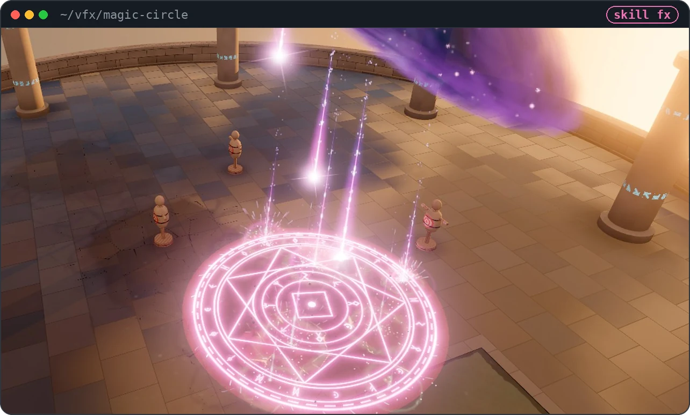
       <b>Magic Circle</b>
    </td>
  </tr>
</table>

<!-- ===================== 웹 ===================== -->
## `~/web`

<table>
  <tr>
    <td colspan="2" align="center">
      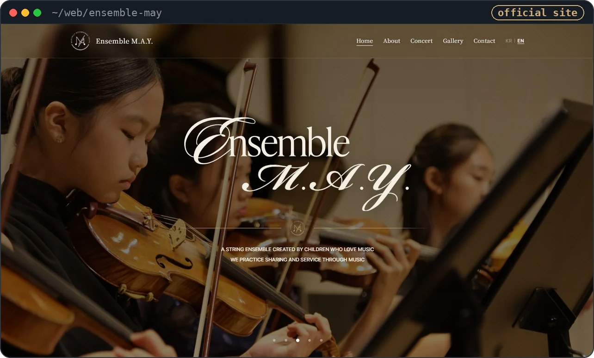
       <b>Ensemble M.A.Y.</b> &nbsp;·&nbsp; 음악을 사랑하는 아이들의 현악 앙상블 공식 홈페이지
    </td>
  </tr>
  <tr>
    <td width="50%" align="center">
      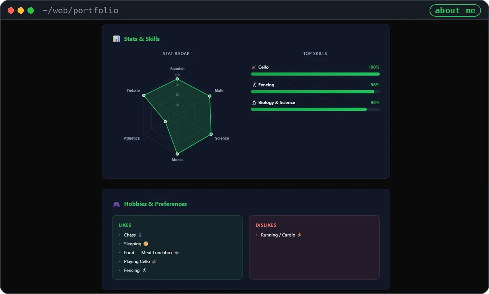
       <b>Portfolio</b> &nbsp;·&nbsp; 스탯 레이더로 보는 나
    </td>
    <td width="50%" align="center">
       
      <code>$ mkdir ~/web/your-next-project</code>
        
      다음 작품이 여기에 들어올 차례 ✍️
        
    </td>
  </tr>
</table>

 

  <code>exit 0</code> &nbsp;·&nbsp; Made with 💜 by CIT-Code-Academy students · 지도 <a href="https://github.com/gyuribaik">백규리T</a>

