<!-- ===================== 소개 ===================== -->
<h1 align="center">학생들의 작업공간입니다 🌱</h1>

  

 

<!-- ===================== 게임 ===================== -->
## 🎮 Games

<table>
  <tr>
    <td align="center" width="50%">
      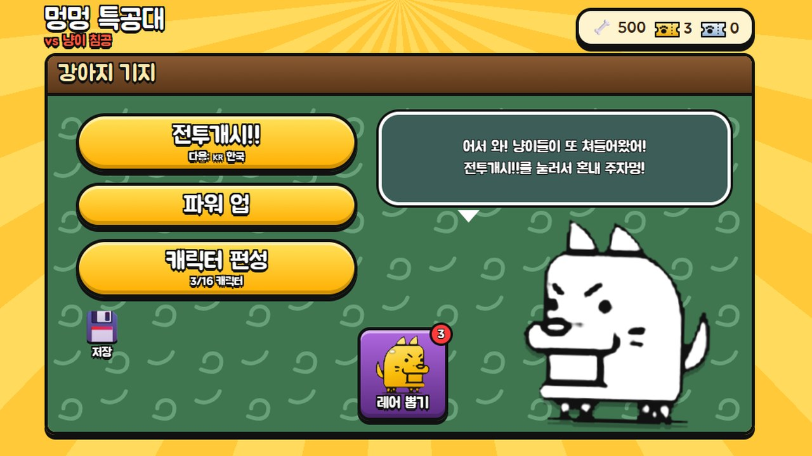 
      <b>멍멍 특공대</b> 냥코 대전쟁 패러디 · 로비 &amp; 뽑기
    </td>
    <td align="center" width="50%">
      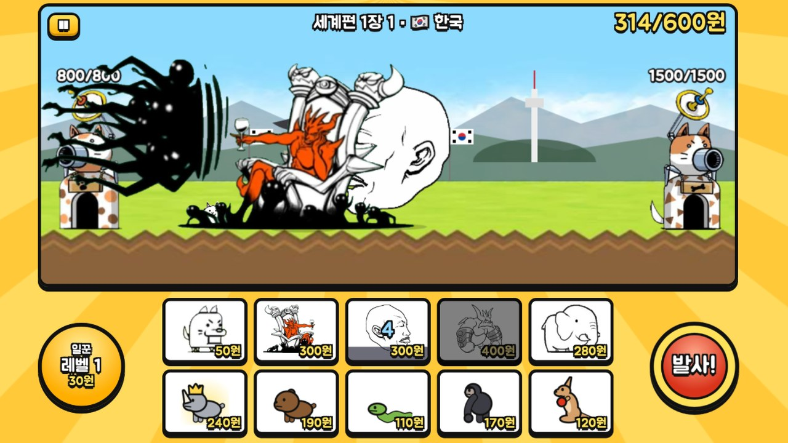 
      <b>멍멍 특공대</b> 세계편 스테이지 전투
    </td>
  </tr>
  <tr>
    <td align="center">
      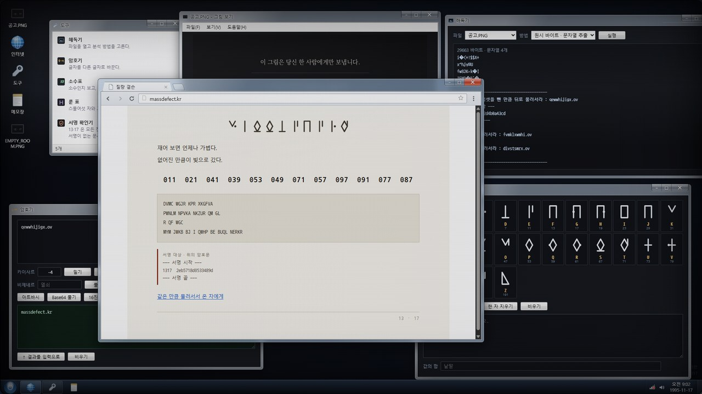 
      <b>브라우징 탈출 게임</b> 가상 데스크톱에서 암호를 풀어내는 퍼즐
    </td>
    <td align="center">
      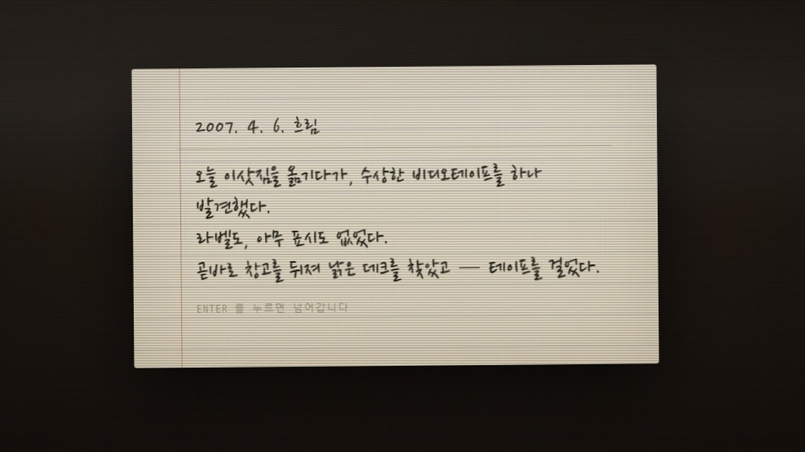 
      <b>브라우징 탈출 게임</b> 스토리 연출 · 2007. 4. 6. 의 일기
    </td>
  </tr>
  <tr>
    <td align="center">
      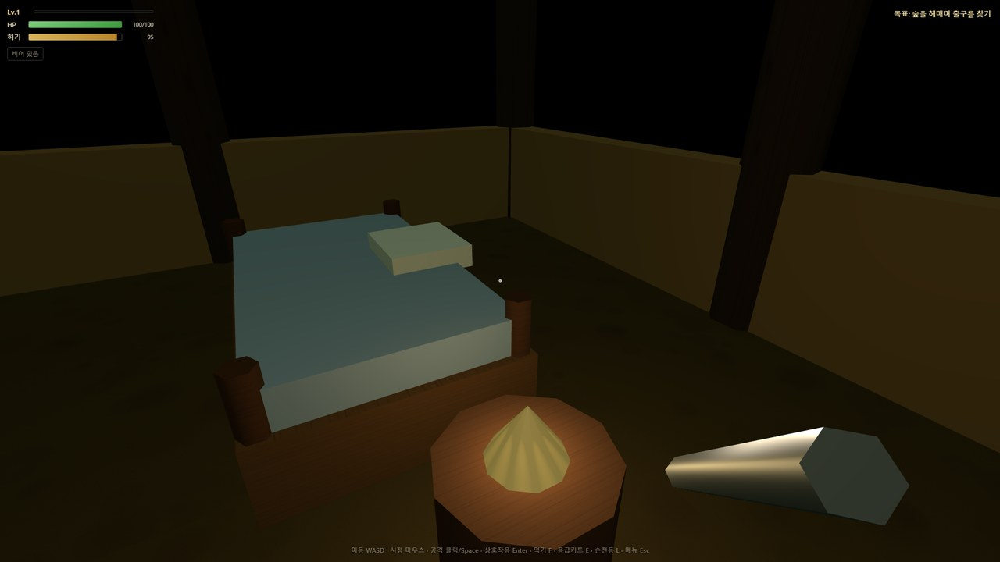 
      <b>시설 탈출 게임</b> 1인칭 3D 생존 · HP / 허기 시스템
    </td>
    <td align="center">
      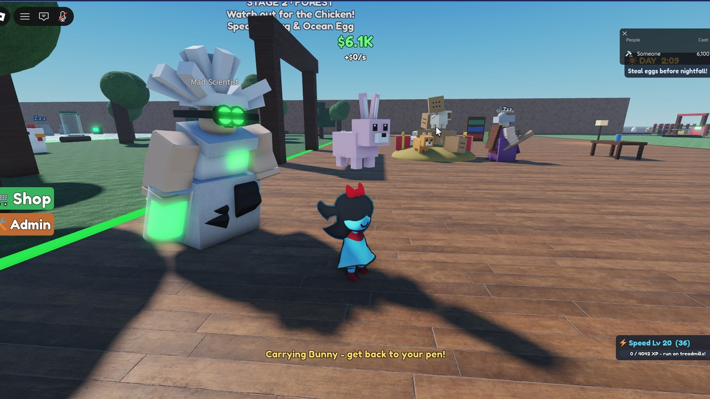 
      <b>펫 가져오기</b> 로블록스 · 밤이 오기 전에 알을 훔쳐라!
    </td>
  </tr>
  <tr>
    <td align="center">
      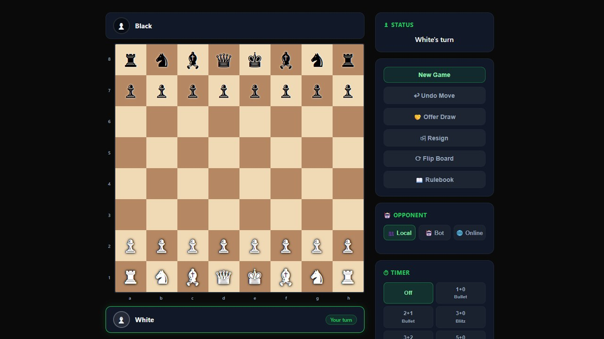 
      <b>Chess</b> 전체 룰 · 봇 / 온라인 / 타이머
    </td>
    <td align="center">
      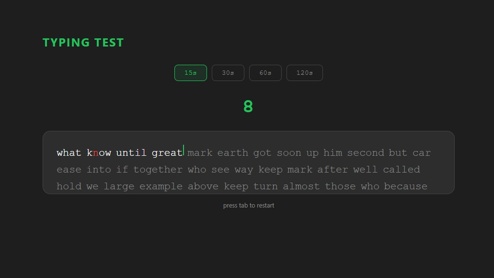 
      <b>Typing Test</b> 15 · 30 · 60 · 120초 타자 연습
    </td>
  </tr>
</table>

<!-- ===================== 이펙트 ===================== -->
## ✨ Game VFX

<table>
  <tr>
    <td align="center" width="50%">
      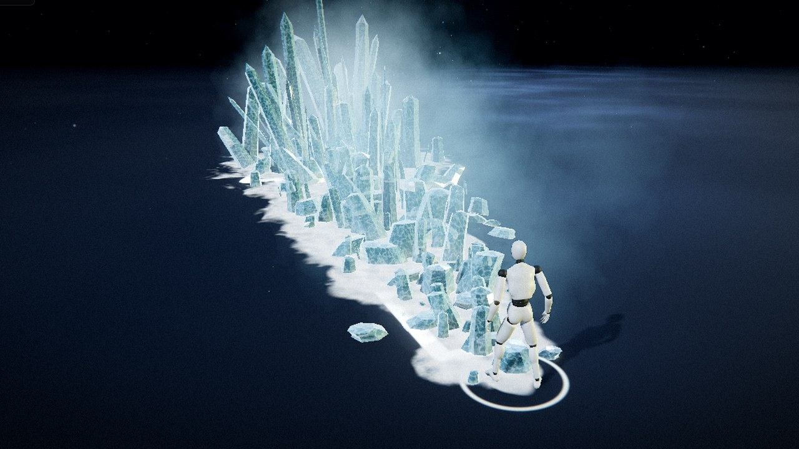 
      <b>Ice Crystal</b> 지면을 따라 솟아오르는 얼음 스킬
    </td>
    <td align="center" width="50%">
      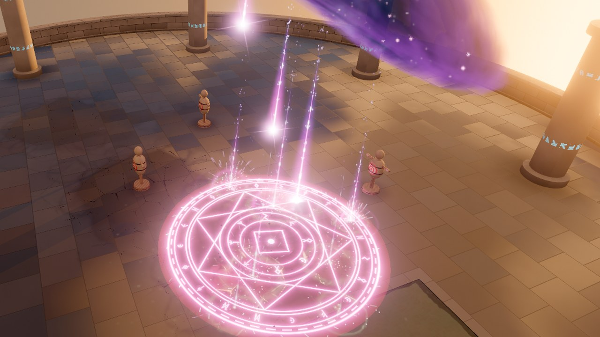 
      <b>Magic Circle</b> 소환 마법진 &amp; 빛기둥
    </td>
  </tr>
</table>

<!-- ===================== 웹 ===================== -->
## 🌐 Web

<table>
  <tr>
    <td align="center" width="50%">
      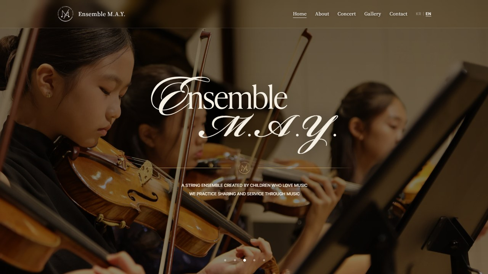 
      <b>Ensemble M.A.Y.</b> 현악 앙상블 공식 홈페이지
    </td>
    <td align="center" width="50%">
      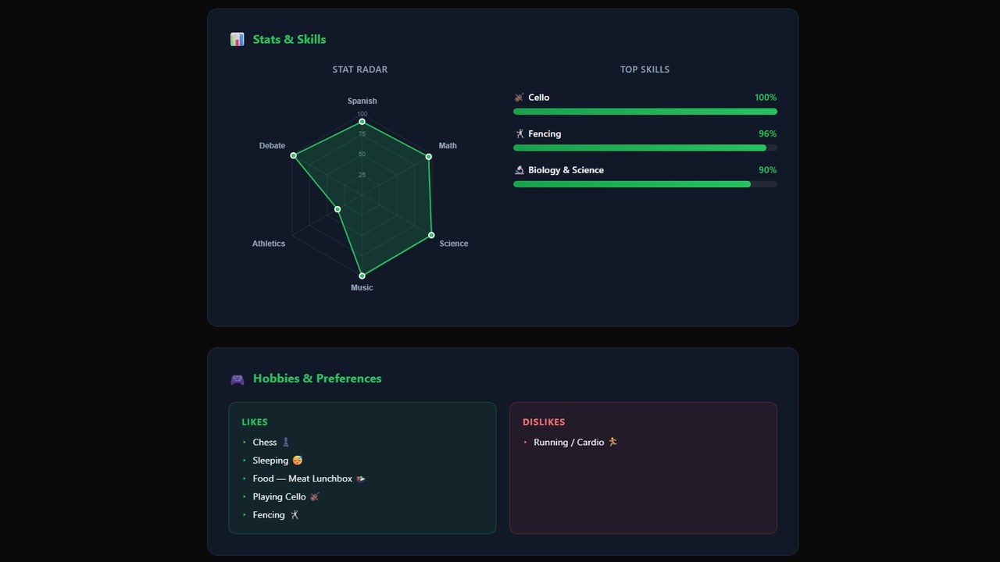 
      <b>Personal Portfolio</b> 스탯 레이더 차트 · 취미 소개
    </td>
  </tr>
</table>

 

  Made with 💜 by CIT-Code-Academy students · 지도 <a href="https://github.com/gyuribaik">백규리T</a>

